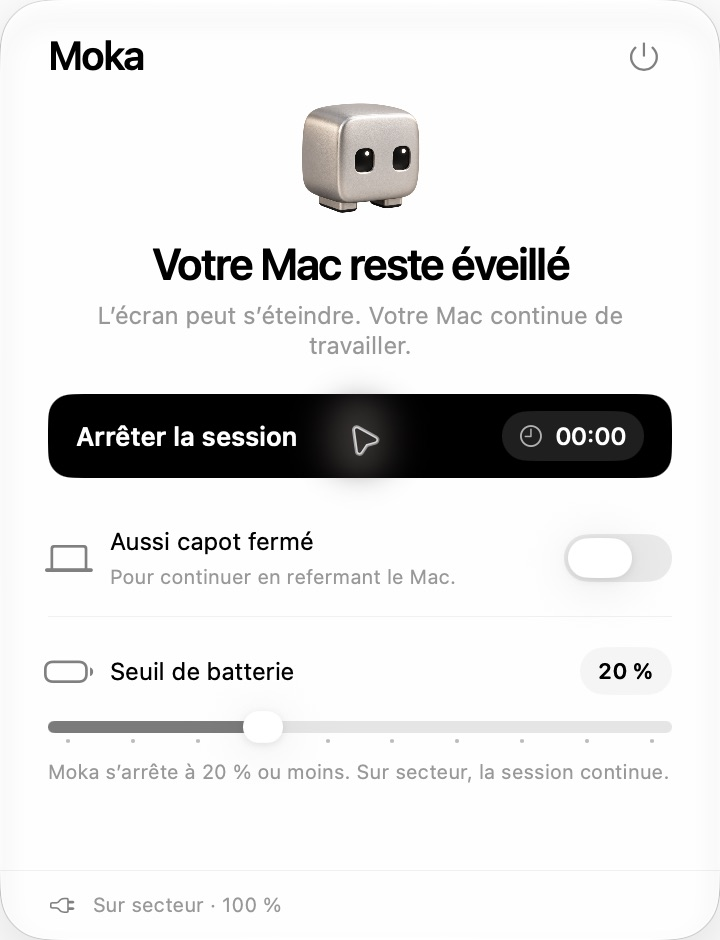

# Moka

<p align="center"></p>

Version actuelle : **3.0.1**. [Télécharger l’application](https://github.com/theoduvivier/Moka/releases/latest).

Une application native dans la barre des menus, avec trois commandes sur un seul panneau :

- **Garder le Mac éveillé** démarre la session ; **Arrêter la session** l’arrête. L’écran peut s’éteindre normalement, les tâches continuent. Le bouton affiche seulement le temps écoulé.
- **Aussi capot fermé** permet de continuer en refermant le Mac, avec autorisation administrateur.
- **Seuil de batterie** règle l’arrêt automatique entre 5 et 50 %, par pas de 5 %. Sur secteur, ce seuil ne s’applique pas.

Atteindre le seuil arrête réellement la session. Recharger ou rebrancher le Mac ne la redémarre pas : il faut cliquer à nouveau. Les anciennes préférences d’écran, de durée, de téléphone et d’autorisation sur batterie ne sont plus lues. L’application ne contient plus de fonctionnalité Wi-Fi ni de demande de localisation. Il n’y a plus de panneau de réglages.

## Interface

Robot en aluminium au repos ou éveillé, animation courte et réversible, verre système, palette neutre et interrupteur vert. Deux pictogrammes natifs macOS, fins et fixes, indiquent le capot et la batterie. Leur forme ne change pas : le switch et l’indicateur de la barre des menus portent l’état. Aucun MacBook 3D n’est livré. Les animations respectent Réduire les animations ; aucune animation ne tourne au repos. Le panneau mesure 360 × 470 points, limité à l’écran disponible, avec défilement si un message prend plus de place. Un deuxième clic sur l’icône referme le panneau sans arrêter la session. Option-clic active ou arrête directement la session.

Le robot de la barre des menus ferme les yeux à l’arrêt. Le point vert indique le maintien éveillé ordinaire. Une ligne rouge indique le capot actif, une restauration en cours ou une restauration non confirmée. Les infobulles et l’accessibilité annoncent également ces états.

## Fonctionnement

La session utilise une assertion IOKit `PreventUserIdleSystemSleep`, comme `caffeinate -i`. Elle ne maintient pas l’écran allumé et ne supprime pas les assertions d’autres applications. Un arrêt libère l’assertion de Moka. L’application ne redémarre jamais une session au lancement. Une batterie sous le seuil empêche un nouveau démarrage ; sur secteur, le démarrage reste possible.

Le seuil du curseur est transmis au surveillant du capot en cours, sans nouvelle autorisation. Le processus privilégié n’accepte qu’une valeur décimale bornée entre 5 et 50, sans l’exécuter. Si le seuil ne peut plus être écrit, Moka arrête le mode capot. L’application vérifie la batterie toutes les cinq secondes pendant une session ; le surveillant la vérifie toutes les deux secondes. Les timers sont ralentis au repos et ne font pas de travail graphique permanent.

Le capot utilise temporairement `pmset disablesleep`, un réglage global. Un surveillant restaure la valeur précédente à l’arrêt, si l’application disparaît, si sa surveillance s’interrompt, au seuil batterie ou au bout de quatre heures. L’interrupteur ne devient actif qu’après confirmation du lancement. La fermeture de Moka attend le résultat de la restauration.

Si la veille était déjà désactivée avant Moka, cette valeur est conservée et le panneau l’explique. Garder le Mac ventilé, hors d’un sac. Après une coupure brutale, vérifier `pmset -g`. Le comportement physique du capot doit être validé sur chaque modèle : les tests simulés ne le prouvent pas.

## Construire et vérifier

Prérequis : macOS, les outils en ligne de commande Xcode avec un SDK macOS 26 ou ultérieur, et Python 3 pour les tests. Aucune installation de dépendances n’est nécessaire.

```sh
git clone https://github.com/theoduvivier/Moka.git
cd Moka
zsh build.sh
zsh run-tests.sh
```

L’application compilée se trouve dans `build/Moka.app`.

Swift, SwiftUI, AppKit et IOKit. Aucune dépendance tierce, aucun serveur et aucun accès réseau. Les scripts produisent un binaire universel Apple Silicon + Intel, macOS 13 minimum. Liquid Glass est utilisé à partir de macOS 26 ; les versions antérieures ont un fond translucide. Les essais réels ont été effectués sur Apple Silicon avec macOS 27.2 ; les autres environnements n’ont pas été validés sur matériel.

97 vérifications automatisées passent. Les tests couvrent les assertions IOKit réelles, l’arrêt de session au seuil, la migration depuis les anciennes préférences, l’absence de redémarrage automatique, le compteur, les indicateurs, la géométrie du panneau, le lanceur et le surveillant simulés, y compris les changements de seuil en cours. Les simulations ne changent jamais les vrais réglages de veille et n’ouvrent aucun dialogue administrateur.

## Partager

Envoyer `Moka-macOS.zip`. Le destinataire le décompresse, place `Moka.app` dans Applications, puis l’ouvre. Les réglages personnels et mots de passe ne sont pas inclus.

La signature actuelle est locale (ad hoc), sans Developer ID ni notarisation. Gatekeeper peut bloquer l’application sur un autre Mac. Si le destinataire fait confiance à son origine, Apple décrit l’ouverture dans [Confidentialité et sécurité](https://support.apple.com/fr-fr/102445).

Pour une distribution publique : construire avec `MOKA_SIGN_IDENTITY` défini sur un certificat Developer ID Application, puis [notariser le paquet](https://developer.apple.com/documentation/security/notarizing-macos-software-before-distribution). Le mode capot actuel utilise un surveillant temporaire ; un auxiliaire signé géré par SMAppService et XPC serait à envisager pour une distribution publique durable.
